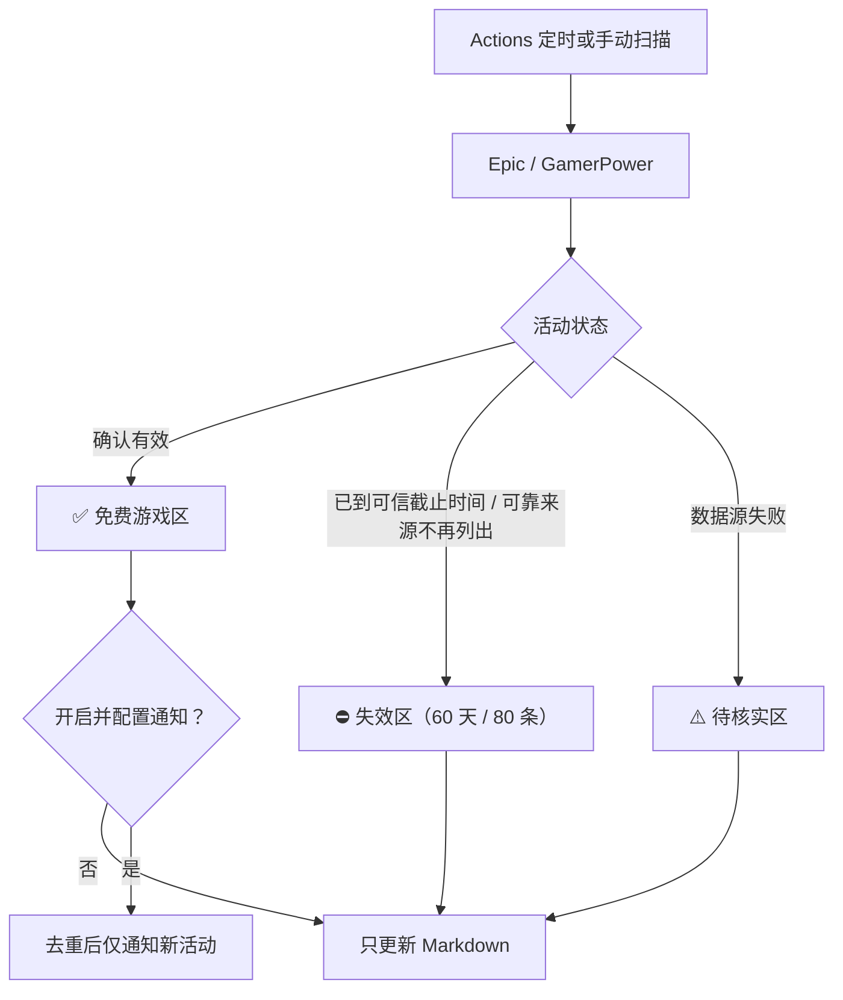

<div align="center">

# 🎮 FreeGame Radar

**Epic / Steam 免费游戏雷达｜GitHub Actions 自动扫描 · iOS Bark / Android ntfy 可选通知**

[](https://github.com/EpochTX/freegame/actions/workflows/radar.yml)


[](./LICENSE)

**自动发现 · 有效/失效分区 · 过期记录归档 · 无密钥静默扫描 · 无需服务器**

[🎁 免费游戏清单](./FREE_GAMES.md) · [🚀 快速部署](#-快速部署) · [📲 安卓 ntfy](./docs/ANDROID.md) · [📖 详细教程](./docs/SETUP.md) · [❓ FAQ](./docs/FAQ.md)

</div>

---

## 📖 项目简介

FreeGame Radar 利用 **GitHub Actions** 定时检查 Epic Games Store 和 Steam 相关的免费游戏活动，并自动更新仓库内的 [免费游戏清单](./FREE_GAMES.md)。清单将**正在免费领取**的 Epic / Steam 游戏集中放在最前面；结束、下架或不再收录的活动移到后面的**已结束 / 已失效**区，方便直接查看可领取的游戏。

**推送完全可选：** 未配置任何通知密钥时，任务仍会正常扫描、更新清单，**不会发送 Bark / ntfy 消息**。如需手机提醒，可按需配置 iOS Bark 或 Android ntfy。

> 🎁 **Epic 限时免费｜游戏名称**
>
> 平台：Epic · 截止时间：北京时间（数据源可确定时显示）
>
> 点击通知打开游戏活动页，手动确认领取。
>
> *这是通知格式示意，不代表真实活动。*

本项目**不登录游戏账号、不代替用户下单、不会自动领取入库**。

## ✨ 核心功能

| 功能 | 说明 |
| --- | --- |
| 🎮 Epic 限免 | 从 Epic 公开促销数据识别正在进行的限时免费活动 |
| 🚂 Steam 赠送 | 从 GamerPower 公共数据源筛选 Steam 完整游戏赠送信息 |
| 🕒 自动更新 | GitHub Actions 每 6 小时检查，自动更新活动清单 |
| 📅 时间详情 | 保留首次加入时间和截止时间；Epic 同时显示活动开始时间 |
| ✅/⛔ 分类展示 | 可领取、已失效分区显示，并在各区内按 Epic / Steam 分类 |
| 🗂️ 失效归档 | 已结束或来源不再列出的活动保留最近 60 天、最多 80 条 |
| ⚠️ 异常保护 | 来源查询失败时进入“待核实”，不会误判已失效或重复推送 |
| 🔕 静默运行 | 不设置 `BARK_URL` / `NTFY_TOPIC` 也能正常工作，不推送 |
| 📲 可选通知 | iOS 使用 Bark；Android 可启用 ntfy |
| 🔁 双层去重 | 分通道记录活动 ID，并用规范化名称抑制 45 天内同游戏重复提醒 |
| 🔗 领取直达 | 通知可点击打开对应活动页面 |
| 🧪 自动测试 | Python 标准库实现，附离线单元测试 |

## 🗂️ 游戏清单与状态判断

打开 [FREE_GAMES.md](./FREE_GAMES.md)，无需安装任何软件即可浏览清单：

| 展示区域 | 规则 | 操作建议 |
| --- | --- | --- |
| ✅ 正在免费领取 | 扫描到的有效促销；具有可信时区的截止时间必须尚未到达 | 优先查看，点击游戏名称前往来源页核实 |
| ⛔ 已结束 / 已失效 | 已到可靠截止时间，或来源正常查询后不再列出 | 仅供历史记录参考，不再作为可领取游戏提醒 |
| ⚠️ 状态待核实 | 某平台查询失败、官方 API 退化为备用来源，旧活动不能确定是否仍然有效 | 不贸然当作可领取或已失效，待下次可靠扫描 |

- **自动转移**：游戏结束/从可靠来源消失后移入失效区；重新被来源确认可领时自动移回有效区，不会同时重复展示。
- **历史保留**：失效记录存于 `data/expired.json`，仅保留最近 **60 天**、最多 **80 条**，防止 Markdown 越来越长。
- **临时接口故障**：不会因一次请求失败将整个平台的游戏全部判定失效。若已知可信的截止时间确实过去，仍按过期处理。
- **Steam 时区**：GamerPower 提供的无时区截止日期只原样展示，不按 UTC 猜测；平台仍列出活动时不凭推测日期将其移到失效区。
- **判定边界**：来源“不再列出”不等同于发行商官方宣告结束。地区、库存、兑换条件和领取结果仍以活动页面为准。
- **通知保持独立**：仅对本次扫描核实为可领取的新活动尝试推送；失效记录、待核实游戏不会触发推送。

**时间说明：** `FREE_GAMES.md` 的“加入时间”是本雷达首次记录该活动的时间，不等于官方限免开始时间；本仓库已根据首次扫描提交的 Git 时间回填现有活动的加入时间；没有历史记录可追溯的旧活动则从首次启用追踪后的扫描开始计时。Epic 活动开始与截止时间统一转换为北京时间（UTC+8）；GamerPower 若未声明截止时间的时区，则展示其原始时间并标注“来源未注明时区”，未知期限标注“未公布”。首次加入时间保存在 `data/first_seen.json`，不会随每次扫描重置。

**数据范围：** Steam 部分可能包含第三方领码活动，不一定是 Steam 商店直接免费入库。活动有效期、地区、价格与领取资格均以原页面为准；试玩、DLC 等内容会尽力过滤，但仍可能有遗漏或误报。

## 🚀 快速部署

### 1. Fork 项目

点击右上角 **Fork**。本仓库的工作流位于 [`.github/workflows/radar.yml`](./.github/workflows/radar.yml)。Fork 后如未自动启用 Actions，请在自己仓库的 Actions 页面启用工作流。

### 2. 不配置密钥也能使用

无需填写任何 Secret。扫描将继续运行并更新 [`FREE_GAMES.md`](./FREE_GAMES.md)；没有密钥时**不会发出任何推送**。

如需要手机通知，在 **Settings → Secrets and variables → Actions → New repository secret** 添加：

| 设备 | Secret 名称 | Secret 的值 | 默认 |
| --- | --- | --- | --- |
| iPhone / iPad | `BARK_URL` | Bark 提供的完整 HTTPS 推送地址 | 不配置则不推送 |
| Android | `NTFY_TOPIC` | ntfy 的高随机度主题名（不是 URL） | 工作流默认注释关闭 |

安卓用户还须将 [工作流文件](./.github/workflows/radar.yml) 中 **两处** `# NTFY_TOPIC:` 行取消注释。详见 [Android 教程](./docs/ANDROID.md)。

**停用通知：** 删除对应 Secret 即可。删除 `BARK_URL` 只停止 Bark 消息，**不会停止定时扫描**。不要把真实密钥写进 README、源码、Issue 或普通 Variables。

### 3. 手动检查

在自己仓库的 **Actions → Free Games Radar → Run workflow** 中：

- `scan`：立即检查免费游戏并更新清单；只向已配置的通道发送新活动通知。
- `test`：仅测试已配置的推送通道。未配置任何 Secret 时会正常跳过，不发送消息。

### 4. 定时运行

| UTC | 北京时间（UTC+8） |
| --- | --- |
| 01:17 | 09:17 |
| 07:17 | 15:17 |
| 13:17 | 21:17 |
| 19:17 | 次日 03:17 |

GitHub 的计划任务可能延迟，无法保证准点或实时发现。仅代码更新触发的 `push` 运行用于离线测试，**不会自动扫描或发送通知**。

## 🧩 工作流程



## ⚙️ 可选环境变量

在 GitHub 仓库 **Settings → Secrets and variables → Actions → Variables** 中设置：

| Variable | 默认值 | 作用 |
| --- | --- | --- |
| `EPIC_COUNTRY` | `CN` | Epic 查询地区 |
| `EPIC_LOCALE` | `zh-CN` | Epic 页面语言 |
| `MAX_PUSH` | `8` | 单次扫描每个通知通道最多推送条数（1–20） |

更改地区不保证不同账号具有相同的领取资格。

## 📁 目录结构

```text
.github/workflows/radar.yml    # 自动扫描和可选通知
radar.py                       # 数据源解析、去重、通知实现
tests/test_radar.py            # 离线单元测试
data/current.json              # 当前可领取和待核实的活动
data/first_seen.json           # 游戏首次扫描加入时间（自动生成）
data/expired.json              # 最近 60 天内失效活动（自动维护）
data/sent.json                 # 通知去重记录（不含密钥）
FREE_GAMES.md                  # 自动更新的活动清单
docs/SETUP.md                  # 完整部署指南
docs/ANDROID.md                # 安卓 ntfy 配置
docs/FAQ.md                    # 故障排查
SECURITY.md                    # 安全建议
CONTRIBUTING.md                # 贡献指南
LICENSE                        # MIT 协议
```

本地测试（Python 3.11+）：

```bash
python -m unittest discover -s tests -v
```

更多信息：[完整部署教程](./docs/SETUP.md) · [FAQ](./docs/FAQ.md) · [安全说明](./SECURITY.md)。

## 🔐 安全与免责声明

- **无需 Epic / Steam 账号凭证**；请勿上传游戏账号密码、Cookie、验证码或登录 Token。
- `BARK_URL` 与 `NTFY_TOPIC` 仅应保存在 GitHub Secrets 中。公共 `ntfy.sh` 主题默认没有访问控制，不适合传送隐私内容。
- Bark 的历史存档不设置短期 `ttl`；最终留存时间受推送服务和客户端设置影响。
- 数据源可能更改、限流或不可用；项目不能保证无漏报、零误报或零重复。
- 本项目非 Epic、Valve、GamerPower 或 Bark 的官方产品。

数据来源：[Epic Games Store](https://store.epicgames.com/) · [GamerPower API](https://www.gamerpower.com/api-read)；通知服务：[Bark](https://github.com/Finb/Bark) · [ntfy](https://github.com/binwiederhier/ntfy)。

**开源许可：** [MIT](./LICENSE) · [贡献指南](./CONTRIBUTING.md)
