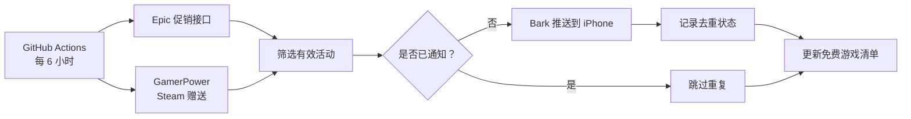

<div align="center">

# 🎮 FreeGame Radar

**Epic / Steam 免费游戏雷达 · 把限免消息直接送到你的 iPhone**

[](https://github.com/EpochTX/freegame/actions/workflows/radar.yml)


[](./LICENSE)

**全自动发现 · Bark 即时推送 · 点击直达活动 · 跨次去重 · 无需 VPS**

[🎁 当前免费游戏](./FREE_GAMES.md) · [🚀 5 分钟部署](#-快速开始) · [📖 完整教程](./docs/SETUP.md) · [❓ 常见问题](./docs/FAQ.md) · [⚙️ Actions](https://github.com/EpochTX/freegame/actions/workflows/radar.yml)

</div>

---

## ✨ 这是什么？

不想每周手动打开 Epic 和 Steam 翻免费游戏？**FreeGame Radar** 帮你定时检查公开活动信息：

> 🎁 **Epic / Steam 发现限时免费游戏！**
>
> 《示例游戏》现可免费领取，具体截止时间以活动页为准。
>
> **轻点 Bark 通知 → 打开活动页面 → 自己确认领取。**
>
> *以上是通知效果示意，并非当前真实活动。*

项目运行在 **GitHub Actions** 上，不用自己买服务器、提供游戏账号密码或让电脑一直开机。

## 📦 能做什么？

| 功能 | 支持情况 | 说明 |
| :--- | :---: | :--- |
| 🎮 Epic 限时免费 | ✅ | 根据 Epic 公开促销接口筛选“原价大于 0、当前 0 元且促销有效”的商品 |
| 🚂 Steam 赠送活动 | ✅ | 读取 GamerPower 的 Steam 活动列表；可能包含第三方领码活动 |
| 📲 Bark 手机推送 | ✅ | 展示真实游戏名称、北京时间截止信息（Epic）与领取链接 |
| ⏰ 定时监控 | ✅ | 默认每 6 小时一次，可手动运行 |
| 🔁 自动去重 | ✅ | 按活动 ID 记录已通知项目，避免每次重复轰炸 |
| 🧪 一键测试 | ✅ | 无需查询游戏即可先测试 Bark |
| 📋 当前活动清单 | ✅ | 扫描后自动更新 [FREE_GAMES.md](./FREE_GAMES.md) |
| 🆓 免费部署 | ✅ | 不需要额外付费服务；受 GitHub Actions 免费额度与政策约束 |
| 🛒 自动下单入库 | ❌ | **不会**登录游戏账号或代替你确认领取 |

**重要区别：** 这里的“免费”是发现活动，并不意味着每个地区、每个账号都有资格；Steam 数据源也可能包含第三方送 Key，而非 Steam 商店直接 0 元购买。请以活动原页面为准。

## 🚀 快速开始

**只需要一个 GitHub 仓库 + iPhone Bark App。** 新用户可先 Fork 本仓库；直接部署到现有仓库则从下面第 2 步开始。

### 1. 获取项目

打开 [EpochTX/freegame](https://github.com/EpochTX/freegame)，选择 **Fork**。GitHub Actions 工作流文件已经配置好，无需 VPS 或自建数据库。

### 2. 设置 Bark 推送

在你的仓库打开 **Settings → Secrets and variables → Actions → New repository secret**。

| 字段 | 填写内容 |
| --- | --- |
| **Name** | `BARK_URL` |
| **Secret** | Bark App 提供的完整 HTTPS 推送 URL，如 `https://api.day.app/YOUR_DEVICE_KEY/` |

> 🔐 **不要**把真实 Bark Key、账号密码、Cookie、Token 填入源码、README、Issue 或 Actions Variables。请放在 **Secrets** 中。曾公开过的 Key 应先在 Bark 中轮换。

> 🕒 **历史消息不再短时过期：** 推送时使用 `isArchive=1` 且不设置 `ttl`。如果你从 Bark 的示例命令复制了 `/title/body?group=example&ttl=600`，请把 Secret 更正为**仅含设备密钥**的完整 HTTPS 地址（`https://api.day.app/YOUR_DEVICE_KEY/`）；脚本也会自动去除这类误带的示例参数。最终历史保留仍受 Bark App 数据和清理设置影响。

### 3. 测试是否收到通知

[打开 Actions → Free Games Radar](https://github.com/EpochTX/freegame/actions/workflows/radar.yml)，选择：

1. **Run workflow** → **mode: `test`**：检查手机是否收到「测试成功」推送。
2. 再执行 **mode: `scan`**：真正查询 Epic / Steam，更新 [活动清单](./FREE_GAMES.md) 并推送尚未记录的新活动。

首次扫描可能连续提醒数个当前活动；之后只推送新发现的活动。

### 4. 之后自动运行

无需额外操作。GitHub Actions 会按下面的 UTC 时刻触发：

| UTC | 北京时间（UTC+8） |
| --- | --- |
| 01:17 | 09:17 |
| 07:17 | 15:17 |
| 13:17 | 21:17 |
| 19:17 | 次日 03:17 |

> GitHub 的定时执行**不是实时任务**，高峰时可能延迟、偶发跳过；监控依赖上游第三方接口。

更完整的图文路径及排错步骤见 **[部署教程](./docs/SETUP.md)**。

## 🧩 工作原理



- **无额外依赖：** 核心脚本仅用 Python 标准库。
- **状态可追踪：** `data/sent.json` 保存已通知活动，`data/current.json` 保存最新扫描结果。
- **消息到达确认：** 仅在 Bark API 返回成功后将该活动标记为已通知；API 成功不代表 iOS 一定实际弹出通知。
- **隐私友好：** 不需要 Epic / Steam 账号凭证，但 Bark Secret 会在 GitHub Actions 执行环境中供本项目脚本使用。

## ⚙️ 可选配置

在 **Settings → Secrets and variables → Actions → Variables** 添加以下普通变量：

| 变量 | 默认值 | 用途 |
| --- | --- | --- |
| `EPIC_COUNTRY` | `CN` | Epic 查询地区（如 `CN`、`US`） |
| `EPIC_LOCALE` | `zh-CN` | Epic 页面语言（如 `zh-CN`、`en-US`） |
| `MAX_PUSH` | `8` | 每次最多推送的新活动数，允许 1～20 |

更改 `MAX_PUSH` 并不改变扫描频率。更改地区后，同一商品可能仍因去重状态而不再次提醒。

## 📁 项目结构

```text
.github/workflows/radar.yml   # 定时运行 / 手动测试 / 状态回写
radar.py                      # Epic、Steam 检测 + Bark 推送
tests/test_radar.py           # 无需联网的单元测试
data/sent.json                # 已通知 ID，用于跨运行去重
data/current.json             # 最新扫描结果
FREE_GAMES.md                 # 自动生成的活动页
docs/SETUP.md                 # 完整部署步骤
docs/FAQ.md                   # 常见问题与故障排查
SECURITY.md                   # 安全须知
CONTRIBUTING.md               # 贡献指南
LICENSE                       # MIT 开源协议
```

## 🛠️ 本地调试

需要 Python 3.11+，不需要 `pip install`：

```bash
python -m unittest discover -s tests -v
```

设置好自己的环境变量 `BARK_URL` 之后可执行：

```bash
python radar.py --test-push
python radar.py
```

**注意：** 在本地运行会改写 `data/sent.json`、`data/current.json`、`FREE_GAMES.md`。

## ❓ 常见问题

**它会自动把游戏放进我的 Epic / Steam 库吗？** 不会。它只发官方/活动页面链接，让你自行确认领取。

**Steam 为什么跳到 GamerPower？** Steam 活动来自公开聚合接口，可能包含第三方领码任务，项目不能保证 Steam 官方商店直接免费入库。

**Actions 成功但手机没消息？** 先在 `test` 模式检查 Bark，确认推送权限与 Secret；新游戏未出现时正常不会发消息。详见 [排错说明](./docs/FAQ.md)。

**能改成每天只推送一次吗？** 可以编辑 [工作流](./.github/workflows/radar.yml) 里的 cron，但请注意 UTC 时间与 GitHub 调度延迟。

更多见 [FAQ](./docs/FAQ.md)。

## 🔒 安全与免责声明

- 本项目不需要游戏账号登录信息。**不要**把游戏账号密码、浏览器 Cookie、第三方登录 Token 交给来历不明的领取脚本。
- 所有项目内容仅作为活动信息提示，实际价格、有效期、领取方式、地区限制以原站为准；并非 Epic、Valve 或 Bark 官方产品。
- 数据源可能故障、调整、延迟，无法承诺 100% 命中所有限免活动。
- 发现安全问题请参见 [SECURITY.md](./SECURITY.md)。

## ❤️ 开源与致谢

数据来源：[Epic Games Store](https://store.epicgames.com/) · [GamerPower API](https://www.gamerpower.com/api-read)。消息推送：[Bark](https://github.com/Finb/Bark)。云端自动化：[GitHub Actions](https://docs.github.com/en/actions)。

欢迎提 [Issue](https://github.com/EpochTX/freegame/issues) 或 [Pull Request](https://github.com/EpochTX/freegame/pulls)；提交前请先阅读 [贡献指南](./CONTRIBUTING.md)。

**License：** [MIT](./LICENSE)。